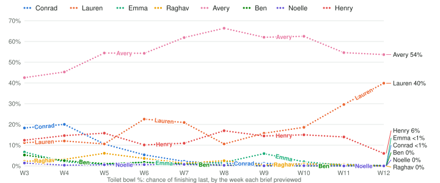
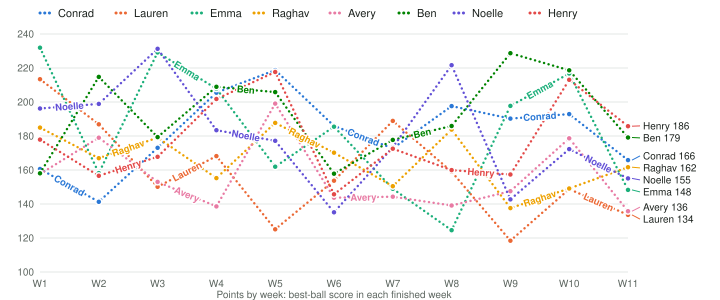

# Best Ball Butts 2026: Week 12 outlook

**As of 2026-11-25.** Weeks 1–11 are final and locked in; Week 12 starts with Thursday's Thanksgiving games. Numbers average 12 simulations (6 sources × 2 noise models, 8,000 seasons each) on the real schedule and bracket.

## TL;DR

- **Ben climbs to 37.8% (was 35.2%)** after beating Emma 179.1–148.3. Ben is 9-2 with the most points, 1st in all 12 runs, and has a 99.8% bye chance.
- **Henry is the week's big riser, +4.3 to 11.3%,** after the week's top score (185.8) beat Noelle. Conrad falls 5.3 to 10.0% despite a win; Noelle (18.4%) and Emma (12.7%) hold 2nd and 3rd.
- **Toilet bowl:** Avery is still the favourite to finish last at 53.7%, but Lauren jumps 10.3 points to 39.9% after a 133.6-point loss to Raghav.

## Standings odds

| # | Manager | Rec | PF | Title % | Range | Playoff % | Bye % | Prior edition (Nov 18) | Δ |
|---|---|:-:|--:|--:|:-:|--:|--:|--:|--:|
| 1 | **Ben** | 9-2 | 2114.7 | **37.8** | 31–47 | 100.0 | 99.8 | 35.2 | +2.6 |
| 2 | Noelle | 7-4 | 1987.1 | 18.4 | 12–26 | 100.0 | 58.0 | 19.3 | −0.9 |
| 3 | Emma | 6-5 | 2010.8 | 12.7 | 7–19 | 99.4 | 8.0 | 13.1 | −0.5 |
| 4 | Henry | 4-7 | 1955.9 | 11.3 | 7–17 | 83.7 | 0.0 | 7.0 | +4.3 |
| 5 | Conrad | 6-5 | 2004.5 | 10.0 | 4–18 | 99.7 | 12.8 | 15.3 | −5.3 |
| 6 | Raghav | 7-4 | 1826.7 | 8.8 | 5–19 | 100.0 | 21.4 | 7.9 | +0.9 |
| 7 | Lauren | 4-7 | 1746.1 | 1.0 | 0.4–2 | 17.2 | 0.0 | 2.3 | −1.2 |
| 8 | Avery | 1-10 | 1716.3 | 0.0 | 0–0 | 0.0 | 0.0 | 0.0 | 0.0 |

## Toilet bowl watch

The two teams that miss the playoffs (seeds 7–8) play one Week 15 game, and its loser finishes last.

| # | Manager | Rec | Toilet bowl % | 7–8 game % | Wk 9 ed. | Wk 10 ed. | Wk 11 ed. | Δ |
|---|---|:-:|--:|--:|--:|--:|--:|--:|
| 1 | **Avery** | 1-10 | **53.7** | 100.0 | 62.0 | 62.5 | 54.6 | −0.9 |
| 2 | Lauren | 4-7 | 39.9 | 82.8 | 15.7 | 18.6 | 29.6 | +10.3 |
| 3 | Henry | 4-7 | 6.0 | 16.3 | 14.4 | 15.0 | 14.0 | −8.0 |
| 4 | Emma | 6-5 | 0.2 | 0.6 | 5.9 | 2.0 | 0.3 | −0.1 |
| 5 | Conrad | 6-5 | 0.2 | 0.3 | 1.2 | 0.9 | 0.8 | −0.6 |
| 6 | Ben | 9-2 | <0.1 | <0.1 | 0.1 | <0.1 | <0.1 | +0.0 |
| 7 | Noelle | 7-4 | <0.1 | <0.1 | 0.1 | 0.1 | <0.1 | +0.0 |
| 8 | Raghav | 7-4 | <0.1 | <0.1 | 0.5 | 0.9 | 0.7 | −0.7 |

## What changed since last week

- **Week 11:** Henry beat Noelle (185.8–155.1), Ben beat Emma (179.1–148.3), Conrad beat Avery (165.8–135.8) and Raghav beat Lauren (161.6–133.6). Dak Prescott (Ben) had the top score at 43.9, ahead of Jonah Coleman (Conrad) at 34.9 and Patrick Mahomes (Noelle) at 31.0.
- **Week 12 games:** Conrad–Henry, Lauren–Emma, Raghav–Ben and Avery–Noelle.
- **Moves:** Conrad released Puka Nacua (on IR until at least Week 15) for Adonai Mitchell, dropped Terrance Ferguson, and added Chimere Dike and Washington D/ST. Raghav swapped Justin Herbert for Cam Ward and added AJ Barner, Samaje Perine and Mike Gesicki. Noelle swapped the injured Michael Wilson and Wan'Dale Robinson for Elic Ayomanor and Xavier Hutchinson. Henry added Jacory Croskey-Merritt. No trades; the deadline is Week 12.
- **Injuries:** Brock Bowers (Raghav), Kenneth Walker III (Emma), Woody Marks and Dalton Kincaid (Avery) and Omar Cooper Jr. (Lauren) all missed Week 11 and are Week 12 questions. Josh Jacobs (Lauren) and Sam Darnold (Noelle) are trending toward a Week 12 return, and A.J. Brown (Avery) is listed doubtful.

## Team by team

- **Ben (37.8%):** 9-2 with the most points, 1st in all 12 runs, with the best projected best-ball week (185.2).
- **Noelle (18.4%):** 7-4 with a 58.0% bye chance, 2nd in 8 of 12 runs. Darnold should be back for Week 12.
- **Emma (12.7%):** 6-5 and 2nd in points; the ESPN source's 2nd choice (17–19%). Walker and Juwan Johnson are Week 12 questions.
- **Henry (11.3%):** 4-7 but 5th in points and 2nd in projected best-ball weeks (182.2), and 2nd at 17.4% with the record removed. Playoff chance 83.7%; Maye is out.
- **Conrad (10.0%):** 6-5 and 3rd in points with a 99.7% playoff chance, but the market and production sources rate the roster low (4–6%).
- **Raghav (8.8%):** 7-4 and 6th in points, with a 100.0% playoff chance and a 21.4% bye chance. Bowers and Dobbins are Week 12 questions; the market source has 19.3%.
- **Lauren (1.0%):** 4-7 and 7th in all 12 runs, with a 17.2% playoff chance and a 39.9% chance of finishing last. Jacobs may return in Week 12.
- **Avery (0.0%):** 1-10 and last in all 12 runs, eliminated from the playoffs.

## Data checks

- **D/ST scoring:** all 151 defense scores in Weeks 1–11 match a recount from Sleeper's raw stats (0 mismatches). Of 17 zeros, 13 are byes (KC Wk 5; MIN, CIN Wk 6; WAS, JAX Wk 7; HOU Wk 8; PIT Wk 9; TB, PHI, DEN Wk 10; GB, SEA, LAR Wk 11). The Raiders' Week 5, Patriots' Week 9, and Buccaneers' and Vikings' Week 11 zeros are real scores the recount confirms.
- **Data source:** rosters, byes and projections came through Raghav's gateway MCP (`sleeper-draft__export_league_snapshot`, sha256-verified), taken after Wednesday morning's waivers. The direct-API fallback was not used.
- **Caveats:** rosters are frozen from here (the trade deadline hasn't passed). Injury news predates Wednesday's practice reports, so Week 12 questions are partial chances: A.J. Brown 0.3; Walker and Cooper 0.4; Dobbins 0.5; Marks, Kincaid, Jacobs and Juwan Johnson 0.6; Bowers 0.65; Boston 0.75; Darnold 0.85; Tuten 0.9. Most are low-confidence.
